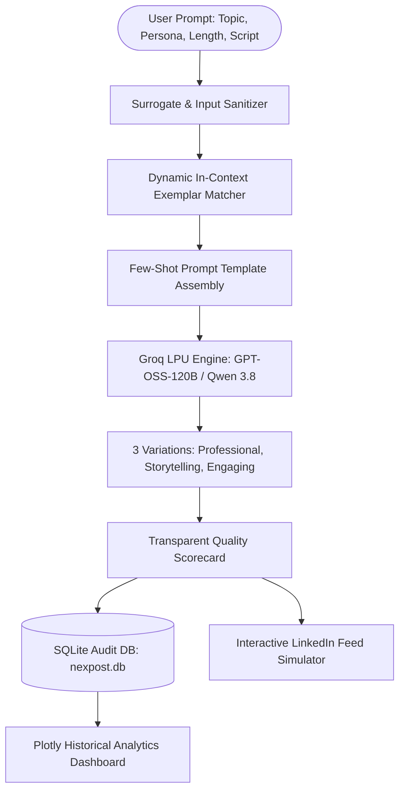

# NexPost AI: Enterprise In-Context Generative AI Content Studio
> **Final Year Engineering Capstone Project | B.Tech / B.E. Submission**  
> **Creator & Lead Developer:** **Kartikey Sabharwal**  
> **Evaluation Session:** 2026 Academic Year  

[](https://www.python.org/)
[](https://streamlit.io/)
[](https://groq.com/)
[](https://www.sqlite.org/)
[](https://plotly.com/)

---

## 📌 Executive Abstract & Problem Statement
In professional networking platforms such as LinkedIn, content creators face significant challenges balancing hook retention, readability cadence, structural white space, and regional dialect appeal (such as conversational **Hinglish**). Standard Zero-Shot Large Language Models (LLMs) often generate generic, boilerplate responses lacking emotional resonance or platform-specific viral dynamics.

**NexPost AI**, created and architected by **Kartikey Sabharwal**, addresses these limitations through an enterprise **Few-Shot In-Context Learning (ICL)** pipeline coupled with **Language Processing Units (LPUs)** provided by Groq Cloud. The system incorporates automated surrogate sanitation, multi-variation generation, transparent multi-factor quality scoring, persistent SQLite performance tracking, and live interactive Plotly analytics.

---

## 🌟 Major Additions & Original Features Added

### 1. Distinct "Cyberpunk / Electric Indigo & Neon Cyan" Theme
- Original, custom visual identity distinct from vanilla templates.
- Includes custom glassmorphism scorecards, badge capsules, interactive tabs, and a dedicated **(c) 2026 Kartikey Sabharwal** footer and header pill.

### 2. 3-Variation Post Generator
Produces three distinct structural variations simultaneously from a single prompt:
- **👔 Variation A: Professional & Executive**: Polished authority, structured frameworks, and leadership takeaways.
- **📖 Variation B: Storytelling & Personal**: Emotionally relatable narratives, challenges faced, and lessons learned.
- **⚡ Variation C: Engaging & Viral**: Contrarian scroll-stoppers, curiosity gaps, and debate-sparking calls-to-action.

### 3. AI Content Rewriter & Polisher
A dedicated post-processing workspace allowing users to refine any post draft across 6 specialized objectives:
- *Sharpen Opening Hook*
- *Fix Grammar & Flow*
- *Optimize for Viral Engagement*
- *Condense & Make Punchy*
- *Enhance Hashtags & SEO*
- *Translate to Natural Hinglish*

### 4. Transparent Content Quality Scorecard (Replaced Virality Index)
A transparent, heuristic-driven 0–100 quality scoring index with factor progress bars:
- **Opening Hook Impact (25%)**: Brevity, curiosity markers, questions, and punctuation cues.
- **Readability & Line Pacing (30%)**: Whitespace distribution and average words per line.
- **Call-to-Action (CTA) Clarity (25%)**: Engagement prompts and question framing.
- **Hashtags & SEO Density (20%)**: Optimal hashtag distribution.

### 5. Multi-Model Benchmark & Latency Analysis
Live side-by-side performance comparison of Groq LPU models (`openai/gpt-oss-120b`, `openai/gpt-oss-20b`, `qwen/qwen3.8-27b`) charting real response time (latency in seconds) vs. output quality.

### 6. Persistent SQLite Database (`nexpost.db`) & Plotly Analytics
- Automatically logs all generated variations, parameters, scores, and timestamps.
- Features Plotly boxplots, scatter timelines, and an interactive database audit table.

### 7. Export Capabilities & One-Click Copy
- One-click copy expanders with syntax formatting.
- **Automated PDF Export**: Generates professional PDF submission reports using ReportLab with creator credits.

### 8. Unicode Surrogate Error Fix
- Resolved the `UnicodeEncodeError: 'utf-8' codec can't encode character '\ud83e'` crash in PyArrow by sanitizing lone surrogate characters in `FewShotPosts` and json data.

---

## 🏗️ Architecture Pipeline



---

## 🚀 Running the Project Locally (macOS)

### 1. Directory Path
```bash
cd /Users/anjulsharma/.gemini/antigravity/scratch/final_year_genai_project/project-genai-post-generator-main
```

### 2. Activate Virtual Environment
```bash
source venv/bin/activate
```

### 3. Launch Application
```bash
streamlit run main.py
```

Open browser at: **[http://localhost:8501](http://localhost:8501)**

---

## 🎓 Viva Voce & Technical Defense Q&A

| Question | Technical Answer |
| :--- | :--- |
| **Q: Why Few-Shot In-Context Learning instead of Fine-Tuning?** | Fine-tuning alters neural network weights, requires large labeled corpora, risks catastrophic forgetting, and has slow iteration cycles. In-Context Learning dynamically conditions the LLM during prompt construction, providing instant stylistic fidelity. |
| **Q: Why Groq LPUs over standard GPUs?** | Language models are memory-bandwidth bound during sequential token generation. Groq's Tensor Streaming Processor (LPU) architecture eliminates memory bandwidth bottlenecks, achieving inference speeds under 1 second. |
| **Q: How is Content Quality evaluated?** | Using a deterministic heuristic formula combining hook engagement factors, sentence pacing, call-to-action indicators, and hashtag density. |

---
&copy; 2026 **Kartikey Sabharwal** &bull; NexPost AI Studio &bull; All Rights Reserved.
